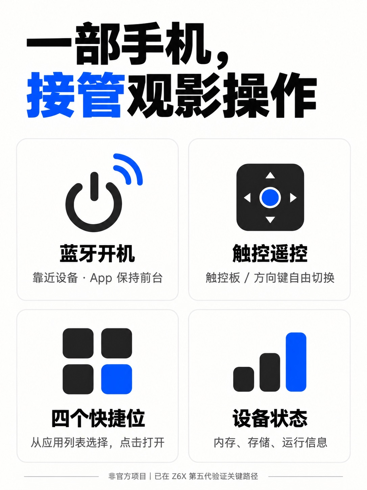

# 极米遥控 · XGIMI Remote

把投影仪的常用操作放进 iPhone：**蓝牙开机、触控遥控、四个可配置的应用快捷位**。

[下载 v2.2.0](https://github.com/NF404301/xgimi-remote/releases/tag/v2.2.0) · [完整更新记录](CHANGELOG.md) · [架构说明](docs/architecture.md) · [宣传文案](marketing/宣传文案.md)

> 个人开发、非极米官方产品，与 Apple 或极米没有隶属关系。关键开机路径仅在一台 Z6X 第五代验证，不承诺所有机型通用。公开源码未指定开放许可证。

## 界面与功能

| 模块 | 功能 | 使用方式 / 范围 |
|---|---|---|
| 电源 | 蓝牙开机、网络待机、快捷指令 | 开机需靠近设备并保持 App 前台；待机先检查 Awake，再发送已验证的电源键 |
| 触控遥控 | 滑动选方向、轻点确认 | 可随时切换可见十字方向键，不强迫使用手势 |
| 常用按键 | 返回、主页、菜单、音量、静音、播放/暂停 | 局域网在线时发送 Android 按键 |
| 文字输入 | 英文、数字、常用符号、退格与回车 | 最多 200 字符；中文使用投影仪屏幕输入法 |
| 四个快捷位 | 自选应用、一点启动 | 首页“编辑”→点选位置→选应用；应用页也可指定位置，选择保存在手机 |
| 系统状态 | 内存、存储、运行时间、前台应用、系统版本、分辨率、系统负载 | 约 12 秒前台刷新；不将负载当作 CPU 使用率，不显示无有效接口的温度/灯源寿命 |
| 屏幕快照 | 获取当前画面、保存相册 | 手动获取，不是实时投屏；受保护内容可能黑屏 |
| 屏幕录制 | 开始、提前结束、自动下载、预览、保存与分享 | 720p / 1.5 Mbps / 无声音 / 最长 60 秒；App 后台可能暂停下载，返回后可重试 |
| 应用管理 | 第三方列表、搜索、打开、停止、安装/更新、卸载 | 标准 APK ≤200 MB；不支持拆分安装包；卸载需要确认且会删除该应用本地数据 |
| 资源清理 | 可回收缓存、后台缓存进程 | 不执行应用数据清除，不删除用户下载；释放量由 Android 决定 |
| 操作日志 | 最近 300 条本地记录 | 不记录发送的文字内容；开机进度仅暂显于左上角，无操作结果浮层 |
| 连接设置 | IPv4 与蓝牙 MAC | 两种地址分别用于局域网控制与蓝牙开机，不能混用 Wi-Fi MAC |

## 下载安装

1. 从 [Releases](https://github.com/NF404301/xgimi-remote/releases) 下载 `XGIMIRemote-v2.2.0-unsigned.ipa`。
2. 这是 **arm64 真机 Release 构建，未签名**，需要使用自己的 Apple 账号/证书与已有签名工具签名后安装；不能点开文件直接安装。不是 App Store 或 TestFlight 包。
3. iOS 最低版本 17。首次使用按需允许蓝牙、本地网络，以及保存时的相册“添加”权限；App 不读取已有相片。
4. 点击首页左上角设备名称，填写投影仪 IPv4 和**蓝牙 MAC**；蓝牙 MAC 不是 Wi-Fi MAC。
5. 在线遥控需手机与投影仪局域网互通，且投影仪已有可用、已授权的 ADB TCP 5555 接口。当前不实现 ADB AUTH 配对，要求认证的设备不能直接使用。
6. 测试开机时保持投影仪接电、使用 App 的待机方式，再靠近设备点击“开机”，保持前台约 20 秒。观察实际画面，不能只凭“广播已开始”判断成功。

公开包不含原开发者的签名描述文件、Apple 账号或手机 UDID。安装和重新签名有效期由你的签名方式决定。不要把投影仪调试端口暴露到互联网。

## 从源码构建

使用 Xcode 打开 `ios-wake/ProjectorWake.xcodeproj`，选择自己的签名 Team 和唯一 Bundle Identifier，连接并信任 iPhone，按系统要求开启开发者模式后构建安装。模拟器只适合检查 UI，无法验证蓝牙发射。

公开源码与 IPA 默认未配置真实蓝牙地址；连接设置中填写后即可生成当前协议的目标 UUID。示例 IPv4 `192.168.1.100` 也需换成自己的设备地址。

## 已验证的开机适配

在本机上，系统休眠键 `223` 待机后多次无法蓝牙唤醒；改成电源键 `26` 待机后，用户确认 App 开机成功，同时监测到 ADB 恢复在线。App 与快捷指令已统一采用 26，且操作前重新检查 Awake，避免重复切换电源。

曾独立抓到 App 实际广播与原有效开机包逐字节一致；因此后来定位待机方式差异时，没有继续把 API“发送成功”当作设备“已开机”。

当前适配格式：蓝牙 MAC 六字节逆序，加 `FF FF FF 33 43 52 4B 54 4D 00` 组成 iBeacon UUID，major/minor/measuredPower 均为 0。此规律仅来自当前设备，不是所有极米的协议保证。地址归一化、UUID 生成和非法输入有独立校验。

## 验证边界

- 已在当前设备验证：ADB 通信、状态读取、文件上传、原生录屏开始/停止/下载、电源键待机后本 App 蓝牙开机。
- 一次资源清理约释放 695 MiB，仅为当次结果，不保证每次能释放同样容量。
- 已开发但完整实机回归尚未全部完成：Photos 保存授权全流程、APK 安装/卸载全流程。
- 录屏不含声音，受保护内容可能黑屏；不提供实时投屏。
- HA、HomePod、NAS 蓝牙网关暂未集成；不能把前台 iPhone App 当作无人值守网关。

## 版本与文件

[v2.2.0 Release](https://github.com/NF404301/xgimi-remote/releases/tag/v2.2.0) 为首次公开发行，附未签名 IPA 和 SHA-256 校验。1.0、2.0、2.1、2.1.1、2.1.2 的功能和优化记录见 [CHANGELOG](CHANGELOG.md)；未分别保留历史 IPA，不伪造旧版发布包。

- `ios-wake/`：SwiftUI、原生 ADB、BLE 配置、快捷指令。
- `tools/`：早期独立 Python 局域网遥控工具。
- `docs/`：架构与安装说明。
- `marketing/`：自媒体文案、AI 概念封面与功能介绍图；概念封面不是实机截图。
- `scripts/package-unsigned.sh`：从源码生成未签名 IPA。

## 发布隐私

工程不含原始抓包、真实设备地址、个人签名 Team、Apple 账号、UDID、固件 APK、录制视频或 Xcode 用户状态。设备配置和日志只保存在安装者本机。请勿把个人抓包和签名文件提交到仓库。
